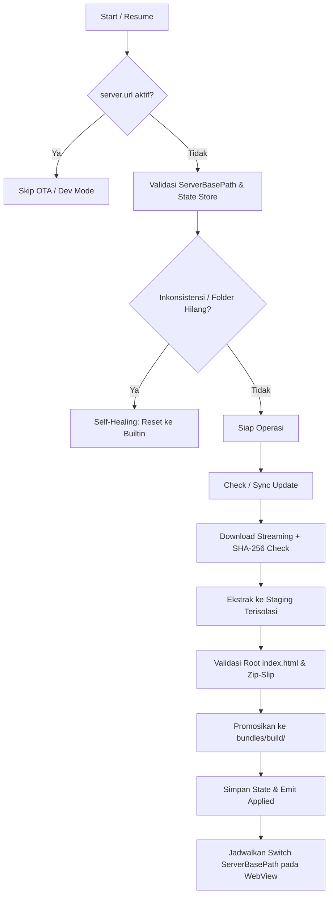

# swbupdater

Capacitor plugin untuk OTA live update aset web pada aplikasi Capacitor (khusus Android).

## Fitur Utama

- **Live Update Web Assets (OTA)**: Unduh, verifikasi, dan pasang pembaruan aset web secara langsung tanpa rilis ulang APK/AAB di Google Play Store.
- **Keamanan Ketat**:
  - Validasi SHA-256 checksum secara streaming sebelum ekstraksi.
  - Proteksi Zip-Slip (path traversal).
  - Validasi wajib file `index.html` pada root bundle ZIP.
  - Batas ukuran ekstraksi dan batas jumlah file entry ZIP.
  - Enforce protokol HTTPS (menolak redirect downgrade HTTPS ke HTTP).
- **Self-Healing State**: Penanganan otomatis jika WebView Capacitor membersihkan `serverBasePath` saat native update.
- **Non-blocking Startup**: Pemeriksaan dan pengunduhan dijalankan di background thread tanpa menahan rendering awal aplikasi.
- **Race Condition Guard**: Penyelesaian Promise sebelum penjadwalan reload WebView untuk mencegah hanging Promise.

---

## Instalasi

```bash
npm install swbupdater
npx cap sync
```

Dapat diimpor bersama `SwbPlugin`:
```typescript
import { SwbPlugin, SwbUpdater } from 'swbupdater';
```

---

## Konfigurasi Capacitor

Tambahkan blok konfigurasi `SwbUpdater` di dalam `capacitor.config.json`:

```json
{
  "appId": "com.wahana.app",
  "appName": "WahanaApp",
  "webDir": "dist",
  "plugins": {
    "SwbUpdater": {
      "updateUrl": "https://domain.com/ota/manifest.json",
      "autoUpdate": false,
      "baseBuild": 1,
      "baseVersion": "1.0.0",
      "allowInsecureHttp": false
    }
  }
}
```

### Opsi Konfigurasi:
| Properti | Tipe | Default | Keterangan |
| :--- | :--- | :--- | :--- |
| `updateUrl` | `string` | `""` | URL absolut endpoint JSON manifest pembaruan. |
| `autoUpdate` | `boolean` | `false` | Jalankan sinkronisasi pembaruan otomatis pada `handleOnStart` / `handleOnResume`. |
| `baseBuild` | `number` | `1` | Nomor build aset bawaan APK. Naikkan nilai ini setiap merilis native APK baru. |
| `baseVersion` | `string` | `"1.0.0"` | String versi aset bawaan APK. |
| `allowInsecureHttp` | `boolean` | `false` | Izinkan URL HTTP non-HTTPS (HANYA untuk lingkungan pengujian/development lokal). |

> [!WARNING]
> Opsi `allowInsecureHttp: true` membawa risiko keamanan man-in-the-middle (MITM). Jangan pernah mengaktifkan opsi ini pada build production!

---

## Format Kontrak Manifest

Server statis Anda menyediakan file `manifest.json`:

```json
{
  "build": 2,
  "version": "1.0.1",
  "url": "https://domain.com/ota/bundle.zip",
  "checksum": "0123456789abcdef0123456789abcdef0123456789abcdef0123456789abcdef",
  "size": 123456
}
```

### Ketentuan Manifest:
- `build`: Bilangan bulat positif (`1..2147483647`). Pembaruan dianggap tersedia jika `remoteBuild > currentBuild`.
- `version`: String versi yang deskriptif dan tidak boleh kosong (misal `"1.0.1"`).
- `url`: URL absolut paket `bundle.zip`. Wajib HTTPS kecuali `allowInsecureHttp: true`.
- `checksum`: 64 karakter heksadesimal SHA-256 dari file `bundle.zip`.
- `size` (opsional): Ukuran file ZIP dalam byte. Jika disediakan, unduhan wajib memiliki ukuran yang persis sama.

---

## Cara Membuat Bundle OTA

Bundle OTA harus dibuat dari direktori hasil build aplikasi web (contohnya `example/dist`):

> [!IMPORTANT]
> Pastikan isi ZIP memiliki `index.html` langsung di root file ZIP, bukan di dalam subfolder seperti `dist/index.html`.

```bash
# 1. Masuk ke folder web project dan lakukan build
cd example
npm run build

# 2. Masuk ke folder dist dan arsipkan seluruh isinya ke bundle.zip
cd dist
zip -r ../bundle.zip .
cd ..

# 3. Hitung checksum SHA-256 dari bundle.zip
# macOS / Linux:
shasum -a 256 bundle.zip
# atau
sha256sum bundle.zip

# 4. Perbarui manifest.json dengan checksum dan ukuran file aktual
```

---

## Pengujian Lokal (Development)

Untuk menguji server lokal dari perangkat Android atau emulator:

```bash
# Mengarahkan port 8080 perangkat Android ke host mesin development
adb reverse tcp:8080 tcp:8080
```

Gunakan konfigurasi:
```json
{
  "plugins": {
    "SwbUpdater": {
      "updateUrl": "http://127.0.0.1:8080/manifest.json",
      "allowInsecureHttp": true
    }
  }
}
```

---

## Alur Pembaruan & Siklus Hidup



### Event State (`updateStateChanged`):
Listener menerima event status berikut secara berurutan:
1. `checking`: Memeriksa manifest pembaruan.
2. `up-to-date`: Bundle lokal sudah menggunakan versi terbaru.
3. `available`: Pembaruan ditemukan di remote.
4. `downloading`: Mengunduh bundle ZIP ke file sementara.
5. `verifying`: Menghitung dan mencocokkan SHA-256 checksum.
6. `installing`: Ekstrak file dan validasi integritas struktur file.
7. `applying`: Menyimpan state dan menyiapkan switch WebView.
8. `applied`: Bundle berhasil dipasang dan switch WebView telah dijadwalkan.
9. `error`: Terjadi kegagalan pada salah satu tahapan.

---

## Batasan & Catatan Keamanan

1. **Khusus Android**: Fitur live update OTA native hanya berjalan pada platform Android. Platform Web menggunakan fallback no-op/penolakan yang aman.
2. **Checksum SHA-256 vs Signature Digital**: Checksum memastikan bundle yang diunduh tidak rusak atau termodifikasi di tengah transmisi terhadap manifest, namun bukan pengganti kriptografi public/private key signature. Pastikan server manifest Anda aman dan dilindungi HTTPS.
3. **UI State saat Reload**: Switch bundle menggunakan `bridge.setServerBasePath()`, yang memicu pemuatan ulang URL WebView. Hal ini akan me-reset memori/state JavaScript pada aplikasi. Pastikan aplikasi Anda menyimpan state penting ke storage lokal sebelum reload.
4. **Batas Ekstraksi**: Batas keamanan instalasi: maksimal 5.000 file entry, maksimal ukuran file individual 50 MB, dan maksimal total ukuran dekompresi 100 MB.

---

## API Reference

<docgen-index>

* [`checkForUpdate()`](#checkforupdate)
* [`sync()`](#sync)
* [`getCurrentBundle()`](#getcurrentbundle)
* [`resetToBuiltin()`](#resettobuiltin)
* [`addListener('updateStateChanged', ...)`](#addlistenerupdatestatechanged)
* [Interfaces](#interfaces)
* [Type Aliases](#type-aliases)

</docgen-index>

<docgen-api>
<!--Update the source file JSDoc comments and rerun docgen to update the docs below-->

### checkForUpdate()

```typescript
checkForUpdate() => Promise<UpdateCheckResult>
```

**Returns:** <code>Promise&lt;<a href="#updatecheckresult">UpdateCheckResult</a>&gt;</code>

--------------------


### sync()

```typescript
sync() => Promise<UpdateResult>
```

**Returns:** <code>Promise&lt;<a href="#updateresult">UpdateResult</a>&gt;</code>

--------------------


### getCurrentBundle()

```typescript
getCurrentBundle() => Promise<BundleInfo>
```

**Returns:** <code>Promise&lt;<a href="#bundleinfo">BundleInfo</a>&gt;</code>

--------------------


### resetToBuiltin()

```typescript
resetToBuiltin() => Promise<void>
```

--------------------


### addListener('updateStateChanged', ...)

```typescript
addListener(eventName: 'updateStateChanged', listenerFunc: (event: UpdateStateEvent) => void) => Promise<PluginListenerHandle>
```

| Param              | Type                                                                              |
| ------------------ | --------------------------------------------------------------------------------- |
| **`eventName`**    | <code>'updateStateChanged'</code>                                                 |
| **`listenerFunc`** | <code>(event: <a href="#updatestateevent">UpdateStateEvent</a>) =&gt; void</code> |

**Returns:** <code>Promise&lt;<a href="#pluginlistenerhandle">PluginListenerHandle</a>&gt;</code>

--------------------


### Interfaces


#### UpdateCheckResult

| Prop               | Type                 |
| ------------------ | -------------------- |
| **`available`**    | <code>boolean</code> |
| **`currentBuild`** | <code>number</code>  |
| **`remoteBuild`**  | <code>number</code>  |
| **`version`**      | <code>string</code>  |
| **`size`**         | <code>number</code>  |


#### UpdateResult

| Prop            | Type                 |
| --------------- | -------------------- |
| **`updated`**   | <code>boolean</code> |
| **`fromBuild`** | <code>number</code>  |
| **`toBuild`**   | <code>number</code>  |
| **`version`**   | <code>string</code>  |


#### BundleInfo

| Prop          | Type                            |
| ------------- | ------------------------------- |
| **`build`**   | <code>number</code>             |
| **`version`** | <code>string</code>             |
| **`source`**  | <code>'builtin' \| 'ota'</code> |
| **`path`**    | <code>string</code>             |


#### PluginListenerHandle

| Prop         | Type                                      |
| ------------ | ----------------------------------------- |
| **`remove`** | <code>() =&gt; Promise&lt;void&gt;</code> |


#### UpdateStateEvent

| Prop          | Type                                                |
| ------------- | --------------------------------------------------- |
| **`state`**   | <code><a href="#updatestate">UpdateState</a></code> |
| **`message`** | <code>string</code>                                 |
| **`build`**   | <code>number</code>                                 |
| **`version`** | <code>string</code>                                 |


### Type Aliases


#### UpdateState

<code>'checking' | 'up-to-date' | 'available' | 'downloading' | 'verifying' | 'installing' | 'applying' | 'applied' | 'error'</code>

</docgen-api>
